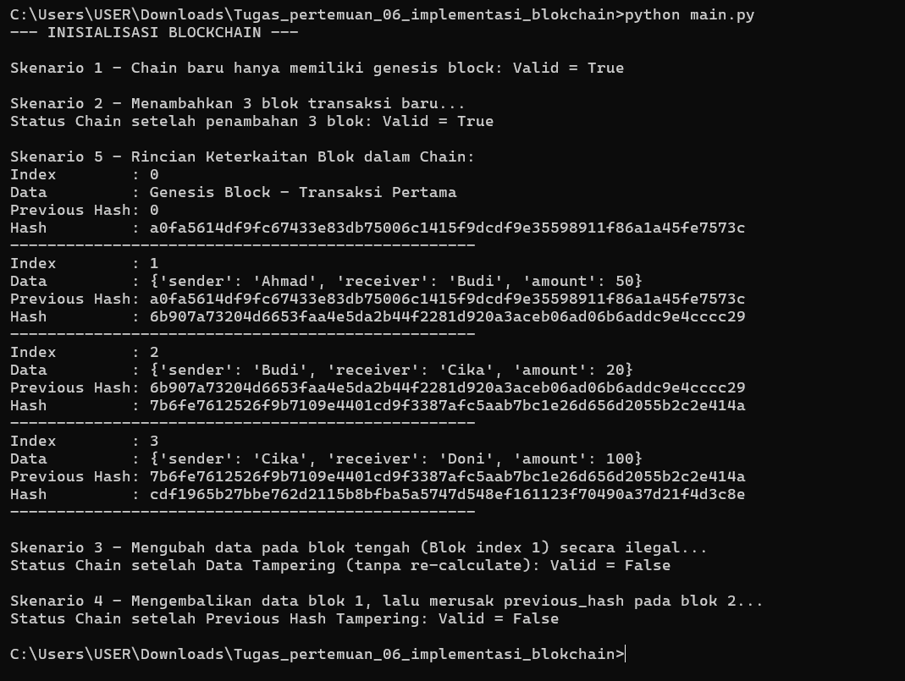

## nama  : Ahmad Khotibul Umam
## prodi : TEKNOLOGI INFORMASI
## NIM   : 1002240062

## Checklist Pengujian Proyek Blockchain

### Status Implementasi dan Pengujian

[✓] Genesis block terbentuk secara otomatis.

[✓] Minimal 3 block tambahan berhasil dibuat.

[✓] Hash berubah ketika data pada block berubah.

[✓] Fungsi `is_valid()` menghasilkan `True` untuk blockchain   normal.

[✓] Fungsi `is_valid()` menghasilkan `False` setelah terjadi tampering.

[✓] README dan bukti pengujian tersedia.

===============================================================

## Deskripsi Singkat Desain Program
Program ini mengimplementasikan konsep dasar teknologi blockchain menggunakan bahasa pemrograman Python secara objek (Object-Oriented Programming). Desain program terbagi menjadi dua kelas utama:
1. **Kelas `Block`**: Merepresentasikan setiap blok di dalam rantai. Setiap blok menyimpan informasi `index`, `timestamp`, `data` (transaksi), `previous_hash`, dan `hash` unik miliknya sendiri yang dihitung menggunakan algoritma kriptografi SHA-256 secara deterministik[cite: 1].
2. **Kelas `Blockchain`**: Mengelola daftar blok (`chain`) yang dimulai dengan pembuatan *Genesis Block* otomatis[cite: 1, 2]. Kelas ini menyediakan fungsi untuk:
   - Menambahkan blok baru (`add_block`) yang secara otomatis mengaitkan `previous_hash` dengan hash dari blok terakhir[cite: 2].
   - Memvalidasi keutuhan rantai (`is_valid`) dengan memeriksa integritas hash isi blok serta konsistensi tautan *previous hash* di sepanjang rantai[cite: 2].

===============================================================

### 3. Penjelasan Mengapa *Tampering* Dapat Dideteksi

Berdasarkan spesifikasi tugas dan hasil pengujian, sistem mampu mendeteksi *tampering* (manipulasi data/rantai) karena alasan berikut[cite: 1, 2]:
1. **Ketergantungan Kriptografis (Cryptographic Linking):** Setiap blok menyimpan nilai `previous_hash` yang merupakan hasil *hash* SHA-256 dari blok sebelumnya[cite: 1]. Jika data atau isi dari sebuah blok diubah di tengah jalan (Skenario 3), maka nilai *hash* blok tersebut akan berubah ketika divalidasi ulang dengan `calculate_hash()`[cite: 2].
2. **Pemutusan Rantai (Chain Breakage):** Perubahan pada suatu blok menyebabkan *hash*-nya tidak lagi cocok dengan `previous_hash` yang disimpan oleh blok setelahnya (Skenario 4)[cite: 2]. 
3. Fungsi `is_valid()` melakukan iterasi menyeluruh untuk mendeteksi ketidaksesuaian matematis ini, sehingga metode validasi akan langsung mengembalikan nilai `False` apabila ditemukan manipulasi sekecil apa pun pada data maupun *pointer* rantainya[cite: 2].

## lampiran gambar pengujian

